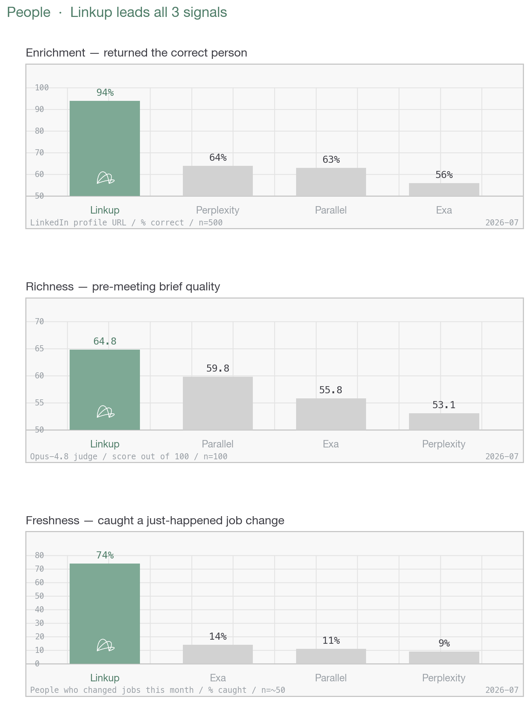
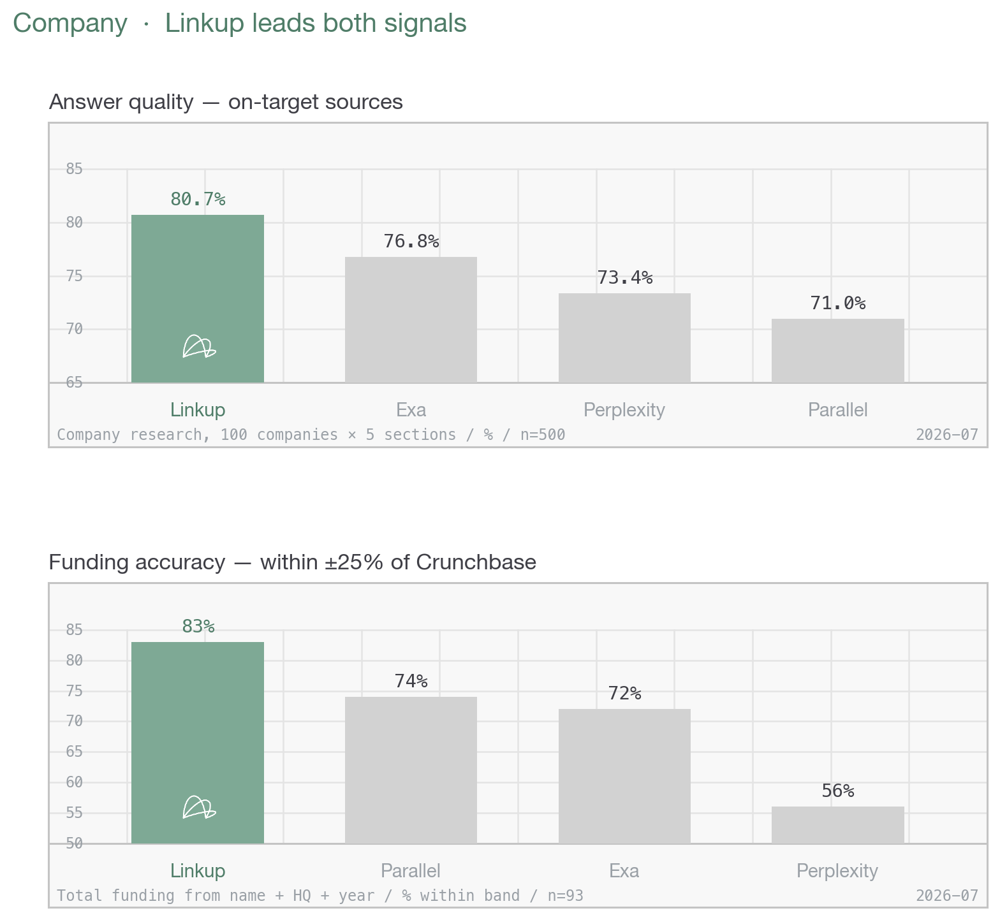
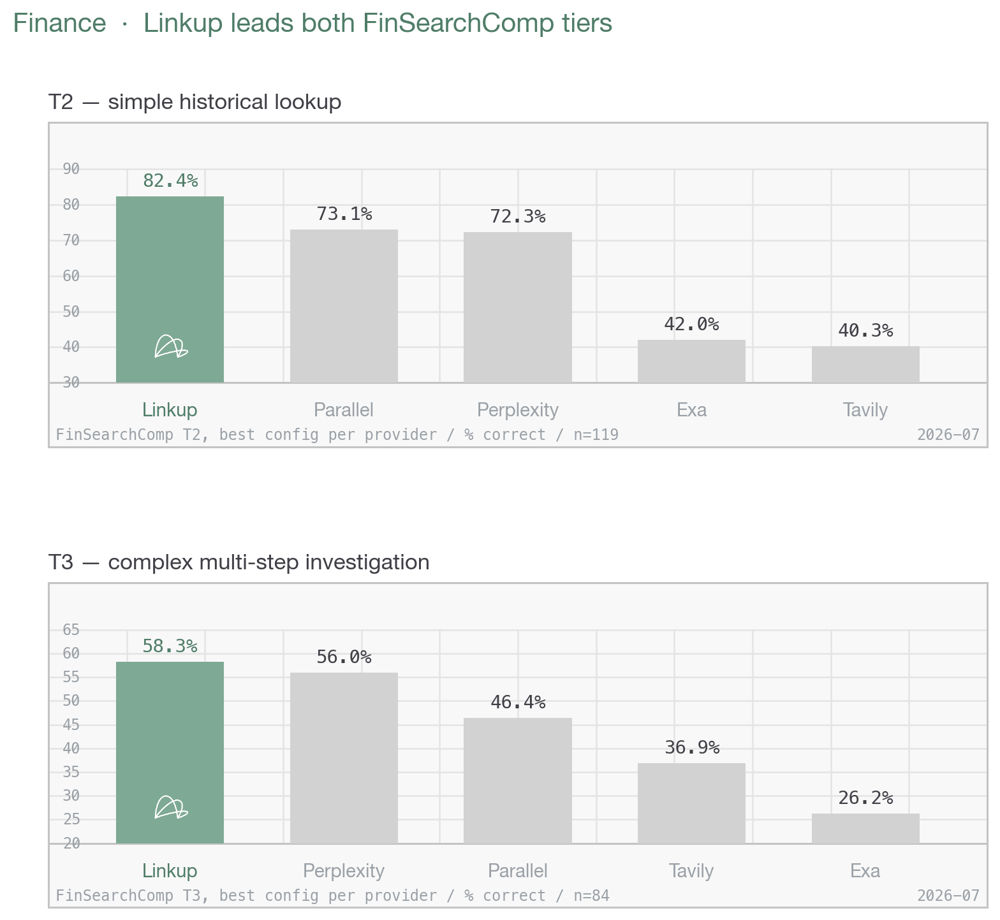
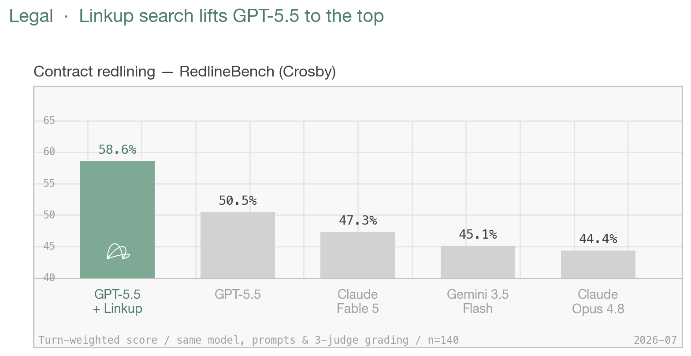

# Linkup Search Benchmarks

The hub for [Linkup](https://linkup.so)'s public, reproducible benchmarks — how a
web-search API performs on the retrieval jobs behind real GTM and legal work.
Every number below links to a repo that ships its dataset, queries, scoring code,
and results, so it can be re-run and re-checked.

**Repos:** [Search Benchmarks on GTM Use-cases](https://github.com/LinkupPlatform/Search-Benchmarks-on-GTM-Usecases) · [Finance — FinSearchComp](https://github.com/LinkupPlatform/linkup-finance-benchmark) · [RedlineBench × Linkup (legal)](https://github.com/LinkupPlatform/linkup-search-redline-bench)

---

## GTM — People

Linkup vs Exa, Perplexity, and Parallel across the three signals that cover the
people-data lifecycle: **get the record right, make it useful, keep it current.**
Linkup leads all three — decisively on the two that matter most for triggers
(correct-person and freshness).



| Signal         | What it measures                           | Linkup   | Exa  | Perplexity | Parallel |
| -------------- | ------------------------------------------ | -------- | ---- | ---------- | -------- |
| **Enrichment** | Correct person from a LinkedIn URL (n=500) | **94%**  | 56%  | 64%        | 63%      |
| **Richness**   | Pre-meeting brief quality, /100 (n=100)    | **64.8** | 55.8 | 53.1       | 59.8     |
| **Freshness**  | Caught a just-happened job change (n=~50)  | **74%**  | 14%  | 9%         | 11%      |


Enrichment is checked against an independent profile DB, so the gap measures
whether the record points at the **right human** before a rep sees it. Freshness
is the highest-value trigger and the widest gap — the failure mode for others is
reporting the right person at their *stale* employer.

---


## GTM — Company

Firmographics and research that drive account scoring, prioritization, and
outbound. Linkup leads both live company signals.



| Signal                                           | What it measures                                      | Linkup    | Exa   | Perplexity | Parallel |
| ------------------------------------------------ | ----------------------------------------------------- | --------- | ----- | ---------- | -------- |
| **Answer quality**                               | On-target sources, 100 companies × 5 sections (n=500) | **80.7%** | 76.8% | 73.4%      | 71.0%    |
| **Specific information (example here: Funding)** | Total funding within ±25% of Crunchbase (n=93)        | **83%**   | 72%   | 56%        | 74%      |


**Answer quality** tracks five distinct GTM signals per company, each fired as its
own query set: what the company **offers**, its **pain → solution** angle, **case
studies** (proof + metrics), named **customers & partners**, and buying-motion
**CTAs** (demo · pricing · sign-up) — the exact fields a rep needs to research and
prioritize an account. Every engine gets one search endpoint, no chaining or
extract, so the score reflects retrieval across all five, not the writer.

**Funding** is the hard, specific case: given only a company's name, HQ, and
founding year, return its **total** equity raised. That number is scattered across
press releases, filings, and trackers — often partial, stale, or conflicting — so
landing within ±25% of Crunchbase means reconciling multiple rounds into one
correct total, not just surfacing a headline figure.

---


## Finance — FinSearchComp

Financial retrieval on [FinSearchComp](https://arxiv.org/pdf/2509.13160) — 635
questions written by 70+ professional financial analysts, each with a single gold
answer verified against primary sources (SEC filings, exchange data) and graded
strictly right/wrong. We run the two historical Global tiers identically across
every system, taking each provider's best research/deep config. **Linkup is 1st on
both tiers.**



| Tier   | What it measures                              | Linkup    | Perplexity | Parallel | Tavily | Exa   |
| ------ | -------------------------------------------- | --------- | ---------- | -------- | ------ | ----- |
| **T2** | Simple historical lookup (n=119)             | **82.4%** | 72.3%      | 73.1%    | 40.3%  | 42.0% |
| **T3** | Complex multi-step investigation (n=84)      | **58.3%** | 56.0%      | 46.4%    | 36.9%  | 26.2% |

**T2** pulls a single fixed figure from a company's past filings — a line item like
revenue, R&D expense, or inventory for a given fiscal year — so it rewards finding
and reading the right primary source. **T3** is the hard tier: reaching the answer
takes multi-step work — pulling figures across several sources or periods and
computing a ranking, ratio, maximum, or derived difference — so it tests
aggregation and calculation on top of retrieval, where the field drops off fastest.

---


## Legal — RedlineBench

Does live web search make a frontier model a better contract negotiator? We layer
a Linkup-backed search skill on top of [Crosby's RedlineBench](https://intelligence.crosby.ai/benchmark)
and run GPT-5.5 against its published closed-book score — same model, prompts, and
3-judge grading; the only change is the agent can look up market norms while it
redlines.



| System                                    | Score (turn-weighted) |
| ----------------------------------------- | --------------------- |
| **GPT-5.5 + Linkup search** (140 tasks)   | **58.6%**             |
| GPT-5.5, published baseline (closed-book) | 50.5%                 |


Adding Linkup search lifts GPT-5.5 by **+8.1 points**, ahead of the published
baseline and every other model on the board.

---


## Methodology

Shared principles across every bench:

- **Each API at its own native surface** — no LLM wrapper between the API and the
score, so we measure the retrieval engine itself. Where a model step is needed,
it's held identical across engines.
- **Independent ground truth** — profile DB, Crunchbase, verified company
identity, or Crosby's own 3-judge panel.
- **Deterministic where possible, judged where necessary** — field-fill and
matching are computed; an LLM judge is used only where strings fail.
- **Reproducible** — datasets, queries, and scoring scripts are committed. Search
is non-deterministic, so committed numbers are one representative run.

Full method, caveats, and reproduction steps live in each source repo.

---


## Layout

```
linkup-benchmarks/
├── README.md                     # this file — the consolidated view
└── assets/
    ├── make_hero_charts.py       # regenerates all four composites
    ├── people_hero.png           # 3 people signals in one image
    ├── company_hero.png          # 2 company signals in one image
    ├── finance_hero.png          # FinSearchComp T2 + T3 tiers
    └── legal_hero.png            # RedlineBench leaderboard
```

Regenerate the charts: `pip install -r assets/requirements.txt && python3 assets/make_hero_charts.py`